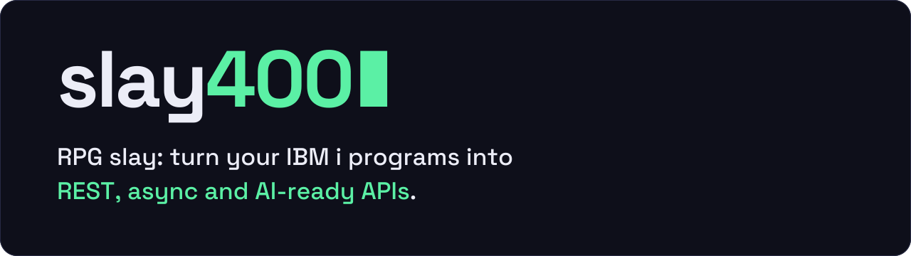

  

# slay400

slay400 turns RPG programs on IBM i (AS/400) into managed, AI-ready APIs, generated from the PCML the compiler already produces.

This repository holds the gateway runtime, Community Edition: it interprets the `descriptor.json` of a bundle built by [slay400-core](https://github.com/generativearchitects-ai/slay400-core) and serves the generated APIs.

**Status: early development.** This repository has no code yet; gateway development starts with its own brief. Nothing here is released.

The project was called glow400 until 2026-11-16.

Licence: Business Source License 1.1 with an Additional Use Grant.

The slay400 name and logo are not licensed under the Business Source License; see `docs/assets/README.md`.
